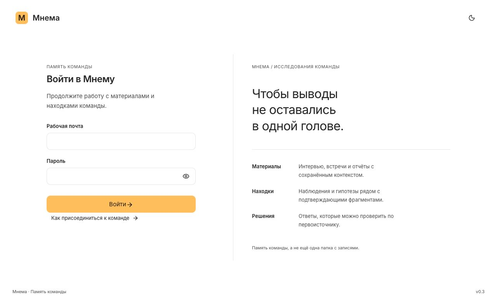

<p align="center"></p>
<h1 align="center">Мнема</h1>
<p align="center">Память команды: материалы, находки и ответы с источниками.</p>
<p align="center">
  <a href="https://github.com/Ambidexterius/mnema/actions/workflows/ci.yml"></a>
  
  
</p>
<p align="center"><a href="#быстрый-старт">Запуск</a> · <a href="CHANGELOG.md">Что изменилось</a> · <a href="docs/DEPLOYMENT.md">Деплой</a> · <a href="CONTRIBUTING.md">Разработка</a></p>

<p align="center"></p>

Мнема — база исследований для небольшой команды. В ней можно хранить интервью и документы, сохранять находки с цитатами и задавать вопросы по материалам. Источники и действия защищены серверными правами.

## Возможности

- Библиотека материалов с поиском, фильтрами и просмотром исходников.
- Извлечение текста из TXT и PDF, OCR сканов, фрагменты с номерами страниц.
- Находки: наблюдения, проблемы, гипотезы и открытые вопросы с привязкой к фрагменту.
- Вход по паролю, одноразовые приглашения и роли «Просмотр» / «Полный доступ».
- Управление участниками владельцем; отзыв доступа действует на уже открытые сессии.
- Подключаемые LLM через совместимый Chat Completions API. Ответ формируется на сервере из доступных источников.
- Локальное распознавание записей через Whisper Small: текст и таймкоды. Сканы PDF распознаёт Tesseract rus+eng.
- Gravity UI, Inter, Lucide, светлая и тёмная тема, сворачиваемая навигация.

## Статус первой версии

Версия 0.4.0 — ранний релиз. Бесплатные Whisper Small и Tesseract устанавливаются в Docker-образ. Для внешней LLM нужен серверный API-ключ; он в поставку не входит. Пока провайдер не настроен, приложение сообщает об этом и не подставляет демонстрационный ответ.

Письма автоматически не отправляются: владелец передаёт ссылку приглашения участнику. Публичная регистрация без приглашения не открывает материалы. Первичная настройка владельца требует отдельного секрета.

Поиск в первой версии текстовый; семантические embeddings, OCR сканов, редактирование расшифровок и проверка восстановления резервных копий остаются следующими этапами. Ответ модели и наличие цитаты не заменяют проверку исследователем.

## Быстрый старт

Нужен Node.js 24.15 или совместимая версия Node 24. Для PDF — утилита `pdftotext` из Poppler; Docker-образ уже содержит её.

```bash
git clone https://github.com/Ambidexterius/mnema.git
cd mnema
npm ci --ignore-scripts
npm run build

export MNEMA_DATA_DIR="${TMPDIR:-/tmp}/mnema-local"
export APP_URL="http://127.0.0.1:4180"
export BETTER_AUTH_SECRET="$(openssl rand -hex 48)"
export MNEMA_SETUP_TOKEN="$(openssl rand -hex 32)"
npm start
```

Откройте [localhost:4180](http://127.0.0.1:4180). При первом запуске создайте аккаунт владельца, используя `MNEMA_SETUP_TOKEN`. Сохраните секреты в своём менеджере секретов. Пароль от 12 символов задаётся в форме; после создания владельца bootstrap не выдаёт дополнительные права.

```bash
npm test
npm run build
```

Тесты используют временную базу и вымышленные данные. Они проверяют регистрацию, сессии, роли, приглашения, исходные файлы и отзыв доступа.

## Деплой и данные

Приложение поставляется одним Docker-контейнером. SQLite и исходники находятся в постоянном каталоге `/data`. Для этой версии нужен один экземпляр приложения; масштабирование на несколько независимых дисков не поддерживается.

[Инструкция Amvera и переменные окружения →](docs/DEPLOYMENT.md)

[Архитектура и ограничения →](docs/ARCHITECTURE.md)

## История и участие

Все изменения перечисляются в [CHANGELOG.md](CHANGELOG.md), выпуски — в [Releases](https://github.com/Ambidexterius/mnema/releases). Вопросы и предложения можно оформить в [Issues](https://github.com/Ambidexterius/mnema/issues). Для изменений кода используйте pull request и [правила участия](CONTRIBUTING.md).

Сторонние библиотеки и шрифты сохраняют свои лицензии: [уведомления](THIRD_PARTY_NOTICES.md). Лицензия на собственный код проекта пока не выбрана.
