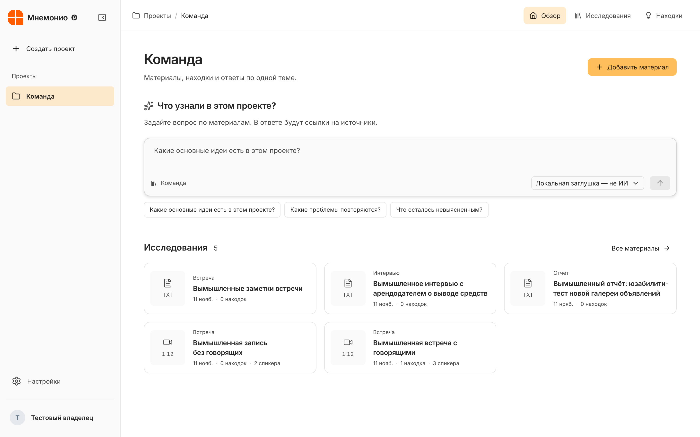

<p align="center"></p>
<h1 align="center">Мнемоника</h1>
<p align="center">Память команды: материалы, находки и ответы с источниками.</p>
<p align="center"><a href="https://github.com/Ambidexterius/mnema/actions/workflows/ci.yml"></a></p>

Мнемоника — база исследований для небольшой команды. Храните интервью и документы, сохраняйте находки с цитатами и задавайте вопросы по доступным материалам. Источники и действия защищены серверными правами пространства.

<p align="center"></p>

## Возможности

- Проекты в меню: материалы, находки и обсуждение в обзоре. Участники и модели изолированы по проектам.
- Текст TXT/PDF/DOCX/DOC/XLSX, OCR сканов через Tesseract rus+eng, локальная расшифровка записей Whisper Small int8 с таймкодами.
- Спикеры в расшифровке: локальное разделение по голосу (pyannote segmentation 3.0 + WeSpeaker ResNet34 через sherpa-onnx), подписи «Спикер 1…N», переименование и перенос реплик.
- Материал открывается окном поверх списка: запись и расшифровка слева, панель «Сводка / Находки / Спикеры» справа, номера сносок ведут к реплике.
- Сводка прямо на странице материала: очередь, сохранение, ссылки на фрагменты и проверка человеком. Для длинного текста — разбиение и объединение; предел 240 000 символов с явной ошибкой вместо скрытого обрезания.
- Находки со статусами «Черновик ИИ», «Проверено», «Отклонено», типом, важностью, цитатой и историей. Читатель видит только проверенные находки и сводки.
- Исправления расшифровки сохраняют оригинал и историю; прежнюю сводку нужно создать заново.
- Загрузка частями по 512 КБ, до 2 ГБ/файл, повтор с сохранённой позиции и идемпотентное завершение. При повторном открытии браузера для возобновления нужно снова выбрать тот же файл.
- Подключаемые LLM через совместимый Chat Completions API; ключи хранятся только на сервере. Вопросы используют выбранные фрагменты, создание сводки по явному действию обрабатывает весь допустимый текст материала.
- Вход по рабочей почте и паролю, приглашения, роли «Просмотр» / «Полный доступ», управление участниками владельцем.
- React/TypeScript, Gravity UI, Inter, Lucide, светлая/тёмная тема и сворачиваемая навигация.

## Статус

0.9.1 — ранний релиз. Для работы LLM нужен собственный серверный ключ. Если провайдер не настроен, сервер сообщает об этом; демонстрационные ответы в публичную поставку не включены.

Whisper Small и Tesseract устанавливаются в Docker-образ. Спикеры размечаются автоматически, имена и роли ставит человек; на коротких репликах разметка ошибается. Скорость и точность на длинных интервью требуют замера. Семантические embeddings и проверка восстановления резервных копий остаются следующими этапами. Ответы и ссылки ИИ требуют проверки исследователем.

Письма автоматически не отправляются: владелец передаёт ссылку приглашения участнику. Открытая регистрация без приглашения недоступна. Адрес репозитория и внутренние имена `mnema` сохранены после переименования продукта.

## Быстрый старт

Нужен Node.js 24.15 или совместимая версия Node 24. Для локальной обработки PDF нужны Poppler/Tesseract, для видео — FFmpeg и настроенная модель Whisper. Docker-образ содержит обработчики.

```bash
git clone https://github.com/Ambidexterius/mnema.git
cd mnema
npm ci --ignore-scripts
npm run build
export MNEMA_DATA_DIR="${TMPDIR:-/tmp}/mnema-local"
export APP_URL="http://127.0.0.1:4180"
export BETTER_AUTH_SECRET="$(openssl rand -hex 48)"
export MNEMA_SETUP_TOKEN="$(openssl rand -hex 32)"
npm start
```

При первой установке оператор создаёт владельца через `POST /api/register`, передавая рабочую почту (`email`), пароль от 12 символов и секрет `setupToken`. Для этого запроса нужен заголовок `X-Mnema-Request: 1` и корректный origin. После создания первого владельца bootstrap больше не выдаёт административные права. Обычные участники регистрируются по приглашению; имя берётся из него. Секреты храните в менеджере секретов, не в Git.

```bash
npm run check
```

Проверка включает TypeScript, серверные тесты и сборку. Тесты работают с временной БД, вымышленными материалами и заменой внешнего провайдера; они не измеряют качество настоящей модели.

## Деплой и данные

Один Docker-контейнер, один экземпляр приложения, постоянный каталог `/data` для SQLite и исходников. Несколько независимых дисков не поддерживаются. Перед эксплуатацией настройте резервные копии и проверьте восстановление на отдельном экземпляре.

[Развёртывание и переменные окружения](docs/DEPLOYMENT.md) · [Архитектура](docs/ARCHITECTURE.md) · [Изменения](CHANGELOG.md) · [Выпуски](https://github.com/Ambidexterius/mnema/releases)

Сторонние библиотеки, шрифты и знак сохраняют авторство: [уведомления](THIRD_PARTY_NOTICES.md), [источник знака](app/licenses/shapes-gallery.md). Лицензия на собственный код проекта пока не выбрана.

## Проекты и перенос исследований

Поиск и отдельная вкладка чата убраны из первой версии. Вопросы и ответы находятся в обзоре проекта. Импорт папки выгрузки с manifest.json из внешней системы исследований сохраняет оригиналы и готовые расшифровки, проверяет SHA-256 и поддерживает повтор без дублирования. Адрес системы-источника задаётся переменной `MNEMA_IMPORT_SOURCE_ORIGIN`; без неё импорт выключен. Архивные карточки черновиков закрыты для читателя и его запросов к LLM. Исходники корпуса и сам manifest в публичную поставку не включаются.

XLSX индексируется по сохранённым значениям, с названиями листов, строками и адресами ячеек. Формулы не пересчитываются, картинки Word не проходят OCR. Общий ответ использует выборку фрагментов и показывает охват. Чаты проектов хранятся только в памяти текущей вкладки.

При переносе проектов готовые выводы из источника не копируются. Сервис сам создаёт новые сводки и находки через выбранную модель. Окно импорта после загрузки ставит материалы в очередь модели. Текст при этом уходит выбранному провайдеру, результат остаётся черновиком ИИ.
