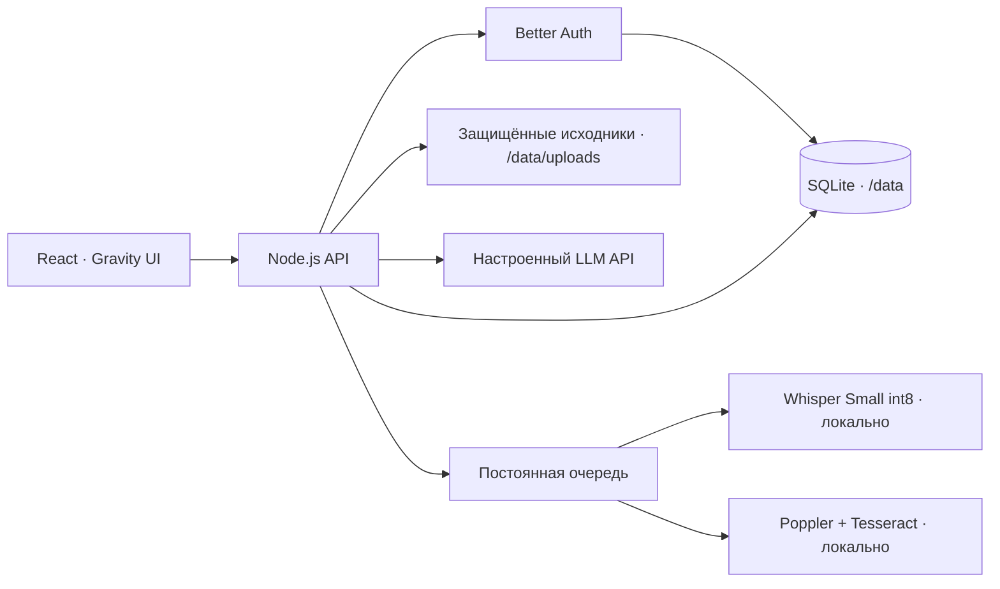

# Архитектура

Один контейнер обслуживает интерфейс, API и worker. База использует WAL, исходники отдаются через проверку сессии. Секреты провайдеров берутся только из окружения сервера. Поддерживается одно пространство с общей библиотекой и двумя ролями; управление подключениями и участниками остаётся у владельца.

Документы разбиваются на текстовые фрагменты. Поиск в первой версии лексический; для ответа выбираются подходящие фрагменты и передаются настроенной модели. Ссылки в интерфейсе ведут к исходным сегментам. Сам ответ модели может ошибаться — первоисточник нужно проверять.

Распознавание записей запускается отдельно, в локальной модели Whisper. PDF автоматически проходит постраничное извлечение текста и OCR сканов. Задания сохраняются в SQLite; после перезапуска незавершённые возвращаются в очередь. Исходники загружаются частями по 512 КБ с резервированием квоты и идемпотентным повтором. После перезапуска задача распознаётся заново, сегменты получают детерминированные идентификаторы. Перед массовой эксплуатацией нужны нагрузочные проверки и восстановление из бэкапа.

Ветка app содержит frontend; server — API и интеграционные тесты. Демо-данные — вымышленные примеры для отдельного локального demo-build. Production не создаёт из них материалы, пользователей или ответы. В публичном репозитории нет рабочих исследований команды.

## Summary and transcript workflow (0.7.0)

A summary is requested explicitly on the material page. The server reads the full permitted transcript in bounded chunks, validates source segment IDs and stores the result with transcript revision, model and review state. Only verified summaries are returned to read-only members. Queued/running tasks interrupted by a server restart become retryable errors; no automatic additional provider call is made.

Transcript corrections preserve the original text and append an audit entry. A correction invalidates the old summary. Upload completion is idempotent; upload sessions are scoped to their user and workspace. With local ASR installed, recording uploads enter the processing queue automatically.
