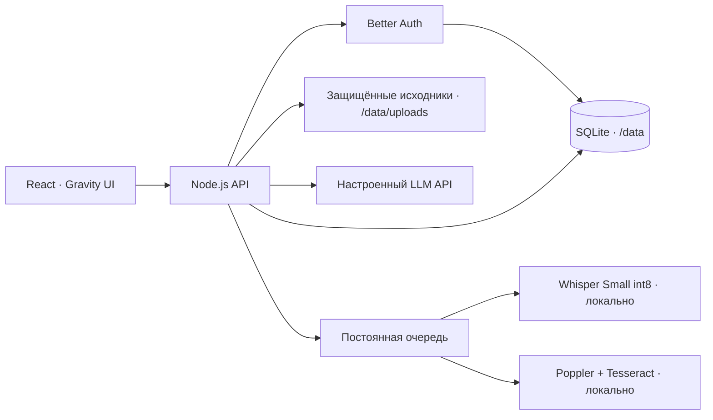

# Архитектура

Один контейнер обслуживает интерфейс, API и worker. База использует WAL, исходники отдаются через проверку сессии. Секреты провайдеров берутся только из окружения сервера. Проекты используют существующие workspace, изолируют библиотеку, модели и две роли; управление подключениями и участниками остаётся у владельца.

Документы разбиваются на текстовые фрагменты. Поиск в первой версии лексический; для ответа выбираются подходящие фрагменты и передаются настроенной модели. Ссылки в интерфейсе ведут к исходным сегментам. Сам ответ модели может ошибаться — первоисточник нужно проверять.

Распознавание записей запускается отдельно, в локальной модели Whisper. PDF автоматически проходит постраничное извлечение текста и OCR сканов. Задания сохраняются в SQLite; после перезапуска незавершённые возвращаются в очередь. Исходники загружаются частями по 512 КБ с резервированием квоты и идемпотентным повтором. После перезапуска задача распознаётся заново, сегменты получают детерминированные идентификаторы. Перед массовой эксплуатацией нужны нагрузочные проверки и восстановление из бэкапа.

Ветка app содержит frontend; server — API и интеграционные тесты. Демо-данные — вымышленные примеры для отдельного локального demo-build. Production не создаёт из них материалы, пользователей или ответы. В публичном репозитории нет рабочих исследований команды.

## Summary and transcript workflow

A summary is requested explicitly on the material page. The server reads the full permitted transcript in bounded chunks, validates source segment IDs and stores the result with transcript revision, model and review state. Only verified summaries are returned to read-only members. Queued tasks survive a restart; interrupted running summaries return to the queue. Completed summaries and prior failures are not recreated automatically.

Transcript corrections preserve the original text and append an audit entry. A correction invalidates the old summary. Upload completion is idempotent; upload sessions are scoped to their user and workspace. With local ASR installed, recording uploads enter the processing queue automatically.

## Import and project context

The client pins each API request to a workspace header and each file URL to a validated workspace parameter. Membership is checked before selecting it. The import API is admin-only and disabled unless `MNEMA_IMPORT_SOURCE_ORIGIN` names the source system; provenance URLs must belong to that origin. It accepts bounded source records, never roles or model settings, checks file SHA-256 and stores provenance. The import dialog transfers originals, transcripts and passports, then calls the analyze endpoint: the server queues each imported material for the project's selected model, so imported text is sent to that provider. Generated summaries and findings are drafts. The API can also store source finding cards as drafts in a separate catalog; the dialog does not use it. Readers see only verified material; uploaded originals remain protected by server membership.

## Private S3 copies

When MNEMA_S3_BUCKET and credentials are configured, ready originals are copied to a private prefix with streamed checksums. Source routes keep workspace authorization and support Range reads from S3, with a retained local fallback. The working SQLite database remains on the persistent volume; an hourly consistent backup is stored in S3. The service owner can verify its SHA-256 and SQLite integrity in a temporary database without replacing production.

Completion favicon state is local to the browser tab and uses observed recording transitions; it is not a durable global notification service. The initial ready history does not create notifications.
