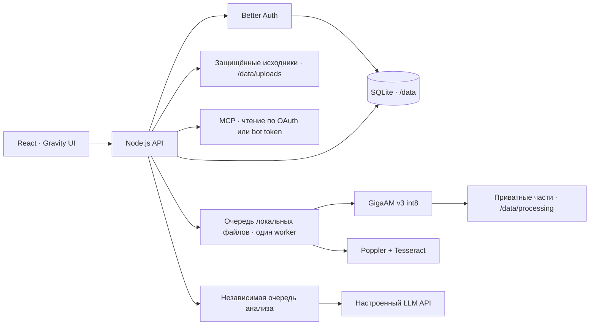

# Архитектура

Один контейнер и один экземпляр приложения обслуживают интерфейс, API и две независимые фоновые очереди. SQLite использует WAL. Все запросы привязаны к выбранному проекту; права, исходники, настройки моделей и участники изолированы на сервере. Клиент хранит обсуждение только в памяти текущей вкладки.

## Права и внешние подключения

Вход и приглашения обслуживает Better Auth. Роль «Просмотр» не получает черновики и отклонённые находки, непроверенные сводки и закрытые импортированные карточки. Глобальный чат применяет роль отдельно в каждом доступном проекте и повторно проверяет доступ после генерации. Чтение исходника требует авторизации и сохраняет Range-запросы.

MCP предоставляет `list_projects`, `search`, `fetch`, `get_findings`. Подключение ограничено явно выбранными проектами, исходной и текущей ролью. OAuth использует PKCE; подписанный access token связан с поколением согласия. Отзыв запрещает старые токены, а повторное согласие не восстанавливает им доступ. Ранее выданным OAuth-подключениям после обновления нужна повторная авторизация. Bot token хранится как хеш и имеет срок 365 дней. MCP не вызывает внутреннюю платную LLM. Проверка официальным SDK на синтетических данных не заменяет проверку внешних ChatGPT/Claude-клиентов.

LLM поддерживает совместимый Chat Completions API, OpenAI Responses и Anthropic Messages. Сохранённые через интерфейс ключи зашифрованы серверным секретом; отдельные подключения могут ссылаться на секрет окружения. Произвольные адреса внутренней сети запрещены.

## Обработка файлов в 0.9.11

ASR, OCR и отдельное определение спикеров используют одну последовательную локальную очередь. Ожидающие документы выбираются раньше следующей записи, текущий процесс не вытесняется. Сводки и поиск находок выполняются в другой последовательной очереди и не ждут длинную ASR. Контекст проекта каждой задачи ограничен её запуском; несколько CPU-распознаваний одновременно не создаются.

Задания файлов сохраняются в SQLite. После перезапуска running возвращаются в queued. Завершённые 15-минутные части ASR записываются атомарно в `/data/processing/<job.id>/asr.json`. То же задание пропускает готовые части; текущая незавершённая часть повторяется. Явный повтор получает новый ID. Checkpoint проверяет версию пайплайна, модель, длительность и структуру данных; повреждённый результат не принимается. Обычное завершение очищает checkpoint. После внезапного завершения процесса он остаётся для продолжения. Подготовка аудио и определение спикеров могут повторяться.

Прогресс содержит измеренный таймкод/часть, без оценки оставшегося времени. Журнал обработки содержит события и длительности без текста интервью. Полный текст сохраняется до необязательного speaker-этапа, поэтому его отдельный сбой не уничтожает завершённую расшифровку. Checkpoints содержат приватный текст и не должны попадать в Git, публичные логи или тестовые артефакты.

Удаление активного локального материала выполняется участником с полным доступом. Контроллер отмены привязан к паре «проект + материал»; сервер ждёт фактического завершения дочернего процесса и очистки временных файлов, повторно проверяет доступ, затем удаляет только этот материал, его локальный исходник и checkpoints. Задания других материалов продолжаются. Пока выполняются сводка или поиск находок, удаление возвращает 409.

## Источники, ответы и анализ

Документы и записи разбиваются на фрагменты с устойчивыми идентификаторами. Чат использует лексический отбор и связанные исходные доказательства видимых находок. Внутри материала сначала сохраняется весь пакет цитат наиболее релевантной находки, затем пакеты следующих находок; между материалами сохраняется чередование. Позднее доказательство не должно вытесняться основными ссылками множества более слабых находок. Число источников ограничено; охват выборки передаётся модели и интерфейсу. Находки помогают выбрать исходный текст и не заменяют его. Полнотекстовый корпус, embeddings и семантический reranking в эту версию не добавлялись. Реальный повтор контрольного вопроса DeepSeek после исправления отбора ещё предстоит.

Сводка обрабатывает весь допустимый текст материала частями, проверяет идентификаторы цитат и сохраняет ревизию, модель и статус проверки. Поиск находок — отдельный проход по полному допустимому тексту. Результат ИИ остаётся черновиком; исправление расшифровки сохраняет оригинал и историю и требует заново создать сводку. Прерванный анализ возвращается в очередь; готовые результаты и прежние ошибки автоматически не пересоздаются.

## Импорт и хранение

Загрузка идёт частями по 512 КБ, с резервированием квоты и идемпотентным завершением. Импорт доступен владельцу проекта, проверяет происхождение и SHA-256 исходников; пользовательские роли и конфигурацию модели через него передать нельзя. Загруженный текст может быть отправлен выбранному провайдеру при анализе. Производственные материалы в репозитории отсутствуют.

При `MNEMA_S3_ENABLED=0` приложение использует постоянный локальный диск Amvera для SQLite, исходников и checkpoints; чтение, запись и резервное копирование в S3 отключены. Существующие удалённые объекты и секреты подключения сохраняются, удалённые копии не обновляются. Удаление локального материала в этом режиме не удаляет прежнюю копию S3. При включённом закрытом S3 исходники копируются с проверкой суммы, а SQLite получает согласованную резервную копию; локальные оригиналы сохраняются. Проверка копии во временной БД не равна полному восстановлению рабочего сервиса; отдельный restore drill, нагрузка, качество ASR и поиск на корпусе остаются открытыми проверками.

Frontend находится в `app`, API и тесты — в `server`. Локальные тесты используют вымышленные данные и подмену провайдера. Production не создаёт из демонстраций пользователей, исследования или ответы. Favicon отмечает наблюдаемое завершение записи в текущей вкладке; это не постоянная общая служба уведомлений.

## Оценка ответов чата

Лайк и дизлайк сохраняют в локальной SQLite подписанный сервером пример: вопрос, ответ, модель, сборку, область поиска и ссылки на исходные фрагменты. Повторное нажатие снимает оценку. Копирование не выставляет оценку. Таблица mnema_answer_feedback предназначена для внутреннего разбора ошибок и подготовки выборки после проверки человеком. Для чтения на сервере: SELECT rating, json_extract(example, '$.question'), json_extract(example, '$.answer') FROM mnema_answer_feedback. Доступ к файлу БД требуется отдельно. Автоматического обучения весов или отправки этих примеров провайдеру нет. С 0.9.37 владелец и управляющие пользователями видят последние 200 оценок в настройках («Оценки ответов», `GET /api/chat/feedback`): вопрос, автора, проекты, ответ, источники и модель, без подписей и прав автора.

## Управление проектами в 0.9.12

Переименование, приглашение участника и удаление адресованы явному ID проекта и доступны владельцу. Сессия возвращает число файлов и до трёх имён из одного списка доступных материалов. Скрытый от читателя материал не раскрывается в превью. Полный доступ к материалам не даёт права управлять участниками.

Удаление проверяет текущее название и роль повторно после чтения запроса. Активные обработка, анализ и загрузка блокируют удаление. Проектные записи, приглашения, ключи моделей, задания и связанные оценки удаляются транзакционно, затем очищаются локальные исходники и временные каталоги. При выключенном S3 старые удалённые копии автоматически не очищаются. Маркер workspaces-v1 в таблице mnema_migrations делает перенос старого пространства однократным: удалённые проекты и членства не восстанавливаются при перезапуске.

Токен --mn-home-radius: 12px ограничен общим чатом и папками на главной. Папки пересчитывают дуги SVG с учётом масштаба. Глобальные токены скруглений Gravity UI не переопределяются: кнопки, поля, вкладки, меню, диалоги и остальные элементы используют значения библиотеки. Собственные оболочки используют её шкалу --g-border-radius-*. Круглые индикаторы и нативные элементы выбора сохраняют семантическую форму.
## Карта маршрутов перед разделением сервера

Точка входа — `createMnemaServer` и его обработчик в `server/server.ts`. Порядок текущих проверок нужно сохранить. Сначала обрабатываются health и OAuth/MCP, до операций записи проверяются origin и заголовок приложения. После входа проверяются права аккаунта, а для проектных маршрутов устанавливается контекст проекта. После чтения тела доступ повторно сверяется через `recheckWrite`.

| Область | Действующие маршруты | Локальные зависимости и общее состояние |
|---|---|---|
| Администрирование | `/api/news`, `/api/ideas` и их действия, `/api/interface-rating`, `/api/chat/feedback`, `/api/models` и каталог | `createProductNews`, `createIdeas`, `createAnswerFeedback`, `modelKeyStore`, SQLite, проверка владельца аккаунта, видимость проектов |
| MCP | `/mcp`, OAuth discovery и маршруты Better Auth, `/api/mcp/*` | `createMcpService`, Better Auth, гранты и сессии в SQLite, `view` для допустимой проекции проекта |
| Авторизация | `/api/auth/*`, `/api/session`, `/api/register`, `/api/registration/*`, `/api/password-reset/*`, аватар и приветствие | Better Auth, `createRegistration`, `session`, таблицы доступа, сессий, приглашений и профилей, лимиты запросов |
| Проекты | `/api/workspaces*`, `/api/invitations`, `/api/users*`, `/api/state` | `createProjectSharing`, `currentWs`, `wsStore`, `getState`, `mutate`, `view`, кэш карточек по версии, права и проекция API |
| Чат и поиск | `/api/chats*`, `/api/chat`, `/api/chat/global`, `/api/research-library`, `/api/research-context` | `createChatHistory`, `globalResearch`, `selectEvidence`, настройки и квоты модели, повторная проверка источников, SQLite |
| Анализ | `/api/project-summary`, сводки и поиск находок по материалу | `nextSummary`, `processSummary`, `processFindings`, `callModel`, снимок проекта, отдельная очередь анализа |
| Материалы и импорт | `/api/upload-sessions*`, `/api/uploads`, `/api/files*`, `/api/studies*`, `/api/imports/source/*`, `/api/storage*` | `reserveUpload`, `expireUploads`, `finalizeUpload`, `uploadBusy`, `deletingStudies`, локальные файлы, SQLite, S3, сохранение заголовков и Range |
| Локальная обработка | Действия обработки записи и определения спикеров в `/api/studies/*` | `queueStudy`, `work`, `processStudy`, `processSpeakers`, `activeCPU`, `transcriptPreviews`, checkpoints на диске |

Расширение получает запрос после авторизации и установки проектного контекста. Разделение маршрутов должно сохранить эту точку вызова и общий способ проверки прав. Статические файлы и SPA обслуживаются после API через `staticCache` и общий механизм ответа.

## Сервер после разделения

`server/server.ts` создаёт HTTP-сервер и останавливает его ресурсы. `runtime.ts` собирает экземпляр приложения, `routes.ts` определяет порядок маршрутов и проверок. Работа с материалами, файлами, проектами, аккаунтом, MCP, чатом, анализом и обработкой находится в модулях из карты выше.

В `processing/` находятся управление заданиями и вызовы обработчиков файлов. Сводки и поиск находок выполняет `analysis/worker.ts`. Обе очереди по-прежнему запускаются одним таймером и работают независимо друг от друга. `projects/store.ts` сохраняет состояние проекта в SQLite прежними транзакциями. `projects/view.ts` формирует ответ по роли и вызывает закрытое расширение через существующий интерфейс.

## Двойная запись состояния проекта

В первом выпуске шага 7 `mnema_workspaces.data` остаётся источником чтения для API и очередей. Создание или изменение проекта пишет исходный JSON и изменённые строки таблиц одной транзакцией. Материалы, реплики, находки, их ссылки, сводки, статусы анализа и выделения копируются в отдельные таблицы. Настройки проекта, модели и права по-прежнему хранятся в своих исходных структурах. Дополнительные поля материалов и реплик сохраняются в метаданных строк.

Строки привязаны к проекту и удаляются вместе с ним. Сверка сохраняет порядок массивов и учитывает старые ссылки на реплики, которых уже нет. `node scripts/check-workspace-projection.mjs PATH_TO_SQLITE` только читает базу и проверяет число строк и их содержимое по проектам. В журнал запуска попадают только суммарные количества и время.

При запуске миграция заполняет отсутствующие таблицы и догоняет записи, сделанные старым образом во время отката. Для этого хранится хеш последней записи JSON. Полное сравнение также обнаруживает расхождение без изменения источника. Откат выполняется переключением образа на прежний, с тем же томом данных.

### Наблюдение на Amvera

При `MNEMA_PROJECTION_AUDIT=1` сервер запускает сверку при старте и каждые 5 минут. Отдельный процесс сравнивает JSON и таблицы в одной транзакции чтения. Результат сохраняется в `/data/.workspace-projection-audit.sqlite` и выводится в лог приложения как `Workspace projection audit`.

72-часовое окно считается от первой успешной сверки. Расхождение, ошибка, смена сборки или пауза дольше 6 минут прерывают окно. Поле `windowComplete` становится истинным после чистой сверки в конце окна. Журнал сохраняет результаты между запусками и находится отдельно от данных проектов.
