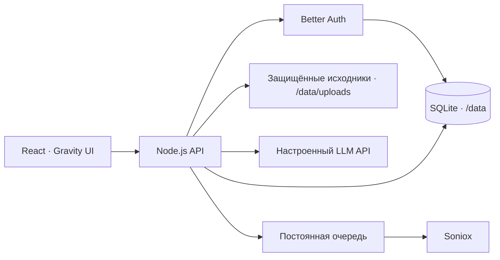

# Архитектура

Один контейнер обслуживает интерфейс, API и worker. База использует WAL, исходники отдаются через проверку сессии. Секреты провайдеров берутся только из окружения сервера. Поддерживается одно пространство с общей библиотекой и двумя ролями; управление подключениями и участниками остаётся у владельца.

Документы разбиваются на текстовые фрагменты. Поиск в первой версии лексический; для ответа выбираются подходящие фрагменты и передаются настроенной модели. Ссылки в интерфейсе ведут к исходным сегментам. Сам ответ модели может ошибаться — первоисточник нужно проверять.

Распознавание запускается отдельно, с передачей файла Soniox. Задания сохраняются в SQLite; после перезапуска незавершённые возвращаются в очередь. Внешние операции имеют окна неопределённости при сетевом сбое; перед массовой эксплуатацией нужны дополнительные проверки повторов, расходов, очистки удалённых данных и восстановления.

Ветка app содержит frontend; server — API и интеграционные тесты. Демо-данные — вымышленные примеры для отдельного локального demo-build. Production не создаёт из них материалы, пользователей или ответы. В публичном репозитории нет рабочих исследований команды.
